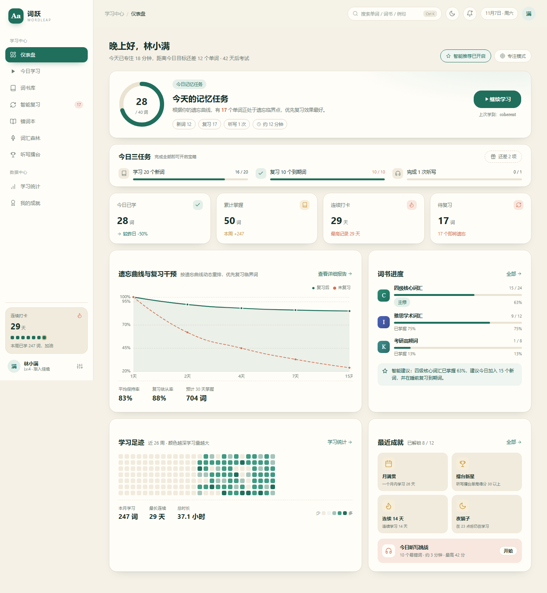
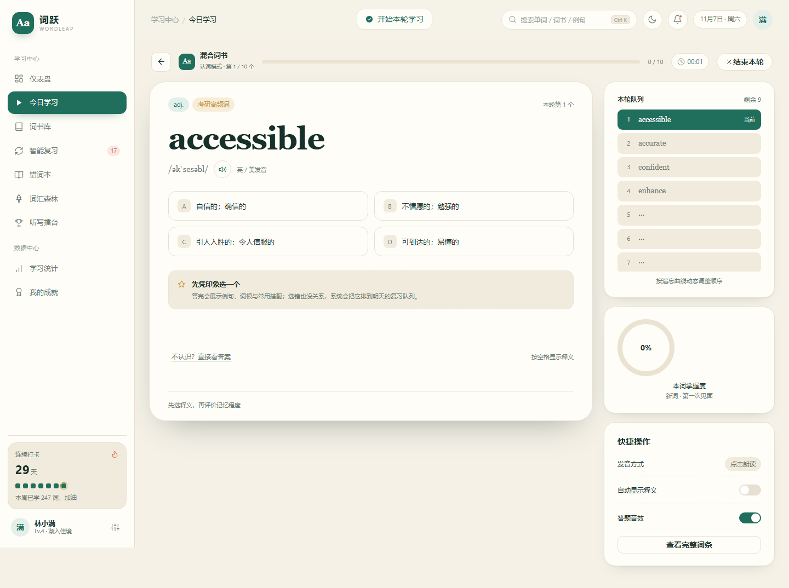
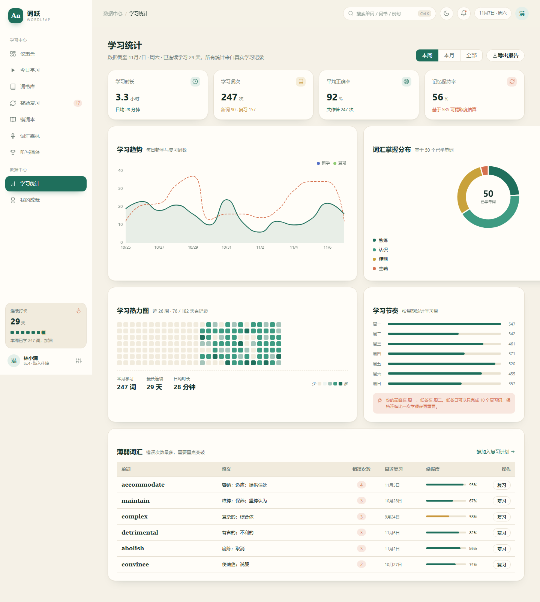
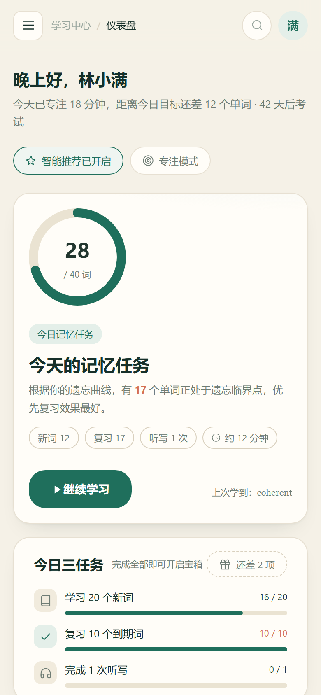

# 词跃 WordLeap · 英语单词背诵智能化系统

> 让每个单词，都在该忘记之前重逢。

**在线体验**：[wenxin1030.github.io/ciyue-wordleap](https://wenxin1030.github.io/ciyue-wordleap/) · **源码仓库**：[GitHub](https://github.com/wenxin1030/ciyue-wordleap)

基于艾宾浩斯遗忘曲线的英语单词背诵系统，课程《Web智能化》结课项目。系统以 Vue 3 + Element Plus 实现，包含学习、复习、词书管理、错词本、学习统计、词汇森林、听写擂台、成就与个人中心等完整流程；所有学习数据保存在浏览器 localStorage，打开即可使用。

## 功能概览

- **仪表盘**：今日任务、记忆曲线、词书进度、学习足迹、最近成就与听写挑战。
- **今日学习**：认词 / 拼写 / 听音三种模式，智能计划、只复习到期、错词强化三种取词来源。
- **词书库**：四六级、雅思、考研、托福、GRE、商务、学术等词书；支持导入词书、新建自定义词书、词书详情与词汇量测试。
- **智能复习**：按遗忘风险排序的复习队列、未来 7 天到期预测、补签卡 / 连续冻结卡 / 双倍经验卡。
- **错词本**：自动收集错词，支持筛选、排序、移除与强化复习。
- **词汇森林**：每掌握 10 个单词种一棵树，待复习单词会变成需要浇水的枯树；词卡图鉴与成长记录。
- **听写擂台**：60 秒限时听写、连击计分、擂台榜与赛季段位。
- **学习统计**：学习趋势、掌握分布、学习热力图、时段偏好、薄弱词汇、学习报告导出（Markdown / 纯文本 / 复制 / 分享 / 打印 PDF）。
- **我的成就**：等级与经验、12 枚徽章、同桌周榜、里程碑、战报图片分享。
- **个人中心**：资料修改、修改密码、学习偏好、每日目标、深色模式、成就墙、退出登录。
- **账号系统**：注册、登录、找回密码说明、表单校验、登录状态与学习数据持久化。

## 技术栈

- Vue 3（Composition API）+ Vue Router 4 + Pinia
- Element Plus 2
- ECharts 5
- Vite 6
- localStorage 本地数据持久化
- 响应式布局：桌面 / 平板 / 手机

## 快速开始

```bash
cd app
pnpm install
pnpm dev
```

生产构建：

```bash
cd app
pnpm build
pnpm preview
```

首次使用请在登录页注册账号；系统会创建默认词书与学习档案。学习记录仅保存在当前浏览器，清除浏览器数据会同时清除学习进度。

## 目录结构

```
.
├─ app/                     # Vue 3 应用
│  ├─ src/
│  │  ├─ components/        # 公共组件、学习组件
│  │  ├─ layout/            # 侧栏、顶栏、移动端 Tabbar
│  │  ├─ views/             # 12 个页面
│  │  ├─ stores/            # Pinia 状态与本地存储
│  │  ├─ mock/              # 词库与演示数据
│  │  └─ utils/             # SRS、统计、发音、海报等工具
│  └─ package.json
├─ design/
│  ├─ screens/              # 页面视觉设计稿
│  ├─ app/                  # 实际运行截图
│  ├─ mockups/              # 设计稿 HTML / CSS
│  ├─ 设计说明与功能清单.md
│  └─ 趣味化与激励机制设计.md
└─ README.md
```

## 设计说明

- 主视觉「墨绿书卷」：纸白底、墨绿主色、陶土橙强调、金色点缀；英文单词使用 Georgia 衬线字体。
- 备选「深夜极光」深色主题：深蓝底、蓝紫主色、薄荷绿辅助色。
- 设计 token、路由、功能模块、SRS 算法与数据模型详见 [设计说明与功能清单](design/设计说明与功能清单.md)。
- 趣味化机制（连击、宝箱、等级、词汇森林、同桌榜、战报）详见 [趣味化与激励机制设计](design/趣味化与激励机制设计.md)。

## 截图

| 仪表盘 | 今日学习 |
| --- | --- |
|  |  |

| 学习统计 | 手机端 |
| --- | --- |
|  |  |

## 说明

本项目为课程设计作品，词库与榜单中的部分数据为演示数据；学习记录仅用于本地展示，不会上传服务器。
